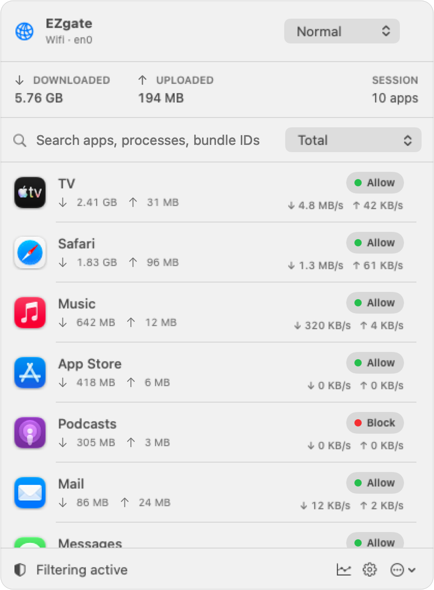
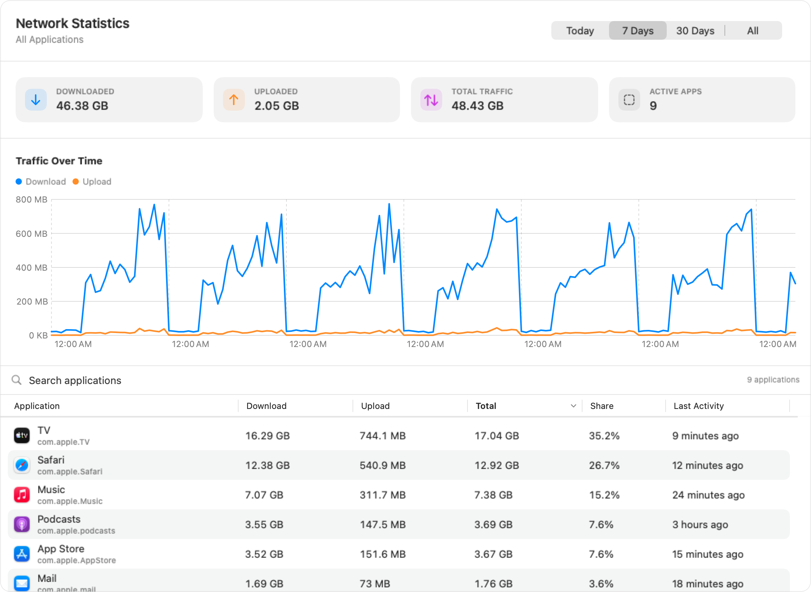

# EZgate

Simple network control for macOS.

> Control what gets through.

## About

EZgate is an open-source, native macOS menu bar utility for understanding which applications use network bandwidth and controlling whether each application may connect. It is built from scratch in Swift and SwiftUI and does not contain code, assets, wording, or proprietary behavior from commercial products.

EZgate shows real traffic only. A Network Extension system extension enforces allow/drop rules and reports per-application byte counters to the menu-bar app over a local XPC connection restricted to the signed EZgate app. macOS only activates it after valid Apple signing/provisioning and explicit user approval.

## Features

- Native `MenuBarExtra` panel
- Per-application download/upload totals and current rates
- Allow/Block rules, applied immediately to new and already-open connections
- Normal, Hotspot, and Restrictive profiles
- Per-profile default policy, including “block all except allowed apps”
- Search by app name, process name, or bundle identifier
- Live sorting by total, download, upload, name, or access state, with animated reordering
- Pause filtering without deleting rules
- Atomic local profile/rule persistence
- Network Statistics window: Today, 7 days, 30 days, or all history, traffic-over-time chart, per-application breakdown
- Session and Today totals backed by SQLite, with a one-click reset of history and live counters
- First-run onboarding that installs and enables the network filter
- Wi-Fi/Ethernet/path-cost monitoring with `NWPathMonitor`
- Launch-at-login setting using `SMAppService`
- Real traffic only; an inactive extension produces an honest empty state
- Unit tests for rules, grouping, formatting, context matching, persistence, and statistics

## Screenshots

<p align="center">
  <picture>
    <source media="(prefers-color-scheme: dark)" srcset="docs/screenshots/menu-dark.png">
    
  </picture>
</p>

<p align="center">
  <picture>
    <source media="(prefers-color-scheme: dark)" srcset="docs/screenshots/statistics-dark.png">
    
  </picture>
</p>

<p align="center"><sub>Rendered from the app's own views with demo data.</sub></p>

## Installation

1. Download `EZgate-<version>.zip` from the [latest release](https://github.com/Axxxxpirine/ezgate/releases/latest). The app is signed with Developer ID and notarized by Apple.
2. Unzip it and move `EZgate.app` to `/Applications`. macOS only installs the network filter from there.
3. Open EZgate, click **Install Network Filter**, then approve EZgate in **System Settings → General → Login Items & Extensions** when macOS asks.

Requires macOS 14 Sonoma or newer, on Apple Silicon or Intel.

## Build from source

Requirements:

- Xcode 16 or newer; the project is currently verified with Xcode 26.6 and Swift 6.3.3
- XcodeGen when regenerating `EZgate.xcodeproj` from `project.yml`
- A paid Apple Developer Program membership to run the filter you build: Network Extension entitlements are not available to free accounts

No Team ID is committed. To sign with your own team, copy `Config/Local.xcconfig.example` to `Config/Local.xcconfig` (ignored by git) and set `DEVELOPMENT_TEAM`. Your Apple Developer account must have the Network Extension and System Extension capabilities and an App Group matching the identifiers in `project.yml`.

Open `EZgate.xcodeproj` and run the `EZgate` scheme, or generate and build from Terminal:

```sh
xcodegen generate
xcodebuild -project EZgate.xcodeproj -scheme EZgate \
  -configuration Debug -derivedDataPath DerivedData \
  CODE_SIGNING_ALLOWED=NO build
```

The unsigned command verifies every target but cannot activate a system extension. Run tests with:

```sh
xcodebuild -project EZgate.xcodeproj -scheme EZgate \
  -configuration Debug -derivedDataPath DerivedData \
  CODE_SIGNING_ALLOWED=NO test
```

## Network Extension

`EZgateNetworkExtension` is a user-space Content Filter system extension. It receives versioned rule snapshots from the app over XPC, resolves the macOS source signing identifier from the flow audit token, and returns an allow or drop verdict. When rules change it also drops already-open connections of newly blocked apps. The XPC service only accepts the EZgate app signed by the same Apple team. If no rule snapshot has been received yet it deliberately fails open.

The extension is not silently activated. A signed build must request system-extension activation and filter configuration, and the user must approve the macOS prompts. See `TECHNICAL_FEASIBILITY.md` for the exact constraints.

## Permissions

Real filtering needs:

- Network Extension (`content-filter-provider` in development/App Store profiles)
- System Extension installation in the containing app
- A common App Group for rules and metadata
- User approval in macOS System Settings
- Developer ID-specific `content-filter-provider-systemextension` entitlements for direct distribution

EZgate never asks users to disable SIP, Gatekeeper, or another macOS protection.

## Privacy

There is no account, cloud, telemetry, or analytics. Real traffic metadata remains on the Mac. Packet contents are neither needed nor stored. See `PRIVACY.md`.

## Architecture

The UI, domain logic, persistence, and filtering target are separated. `RuleEngine` does not import SwiftUI or NetworkExtension. See `ARCHITECTURE.md`.

## Known limitations

- Builds from source can only activate the filter when signed by a paid Apple Developer team with Network Extension profiles.
- SSID access depends on current macOS privacy authorization; iPhone hotspot identity cannot be guaranteed.
- Content Filters allow or drop traffic but do not provide general bandwidth shaping.
- Rules are held in the extension's memory. After a restart, traffic is allowed until the EZgate app is running again; enable Launch at Login to keep filtering continuous.
- Temporary rules, quotas, domain history, and export are not implemented yet.

## Roadmap

See `ROADMAP.md`.

## Contact

Questions and feedback: [info@xprn.dev](mailto:info@xprn.dev). For security issues, follow `SECURITY.md`.

## Contributing

See `CONTRIBUTING.md`. Contributions must use public Apple APIs and must not copy proprietary products or incompatible licensed code.

## License

MIT. See `LICENSE` and `LICENSE_DECISION.md`.
